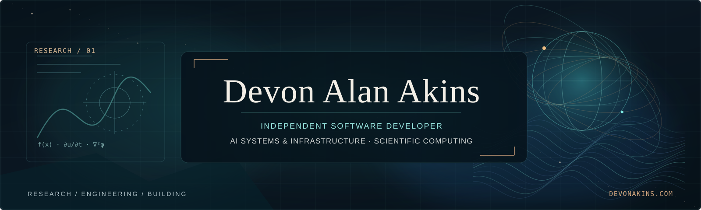

  

# Devon Alan Akins

**Independent software developer · Apple platforms and web · author**

I build software for the web and Apple platforms, explore scientific computing and AI infrastructure, and write. My work connects **open-source infrastructure, human-centered interfaces, scientific computing and useful operations**. My approach is research-first: make the system understandable, test the claims, document the limitations and keep it maintainable and self-hostable where practical.

[Website](https://devonakins.com) · [ANEVUM](https://anevum.com) · [Repositories](https://github.com/devonalanakins?tab=repositories)

  

## What I am working on

- **Apple platforms:** Native interfaces and personal software. The [IREN iOS client](https://github.com/devonalanakins/anevum-web/tree/main/native/iren-ios) is archived source, not a current release; its retired authentication is not suitable for current production.

- **Nona Neuropsychology:** Nonclinical operations, organizational systems and digital experience. Clinical decisions and patient information belong in separately authorized professional systems, not public GitHub repositories.
- **ANEVUM Open Institute:** Developing an independent, non-accredited learning and research experience with interactive lessons and browser-based experiments. [The current implementation is a draft protected preview](https://github.com/devonalanakins/anevum-web/pull/816), not a publicly launched institution or credentialing program. Broader community initiatives remain proposed work.
- **AI systems and compute:** Learning and experimenting with model development, inference, GPU computing, distributed systems and reproducible research. These are technical directions—not claims of a deployed AI cluster or a released foundation model.
- **DevonAkins.com:** Building my public development and research presence, with explicit separation between observed activity, historical snapshots and work in progress.

## Selected repositories

| Project | Purpose | What is actually available |
| --- | --- | --- |
| [ANEVUM Web](https://github.com/devonalanakins/anevum-web) | Open learning, research and creative web experiences | Existing web source; [Open Institute PR #816](https://github.com/devonalanakins/anevum-web/pull/816) is a protected, unmerged preview |
| [DevonAkins.com](https://github.com/devonalanakins/devonakins.com) | Personal portfolio and interactive research website | Public source and ongoing reviewed changes |
| [DevonStation](https://github.com/devonalanakins/devon-station) | Personal operating environment and workflow experiments | Source, prototypes and ongoing development |
| [Knowledge](https://github.com/devonalanakins/knowledge) | Private-first knowledge and file-workspace engineering | Open-source code and controlled development; do not infer production or private-data readiness |
| [Merit](https://github.com/devonalanakins/merit) | Evidence-based review of software and AI-authored changes | Engineering toolkit source; not an independent certification service |
| [Rhen](https://github.com/devonalanakins/rhen) | Experimental programming language and source translation | [M0 implementation is in a draft PR](https://github.com/devonalanakins/rhen/pull/1); no released compiler |
| [Squelch](https://github.com/devonalanakins/squelch) | Touch-first music and audio software | Experimental design and development |
| [Vesper Legacy](https://github.com/devonalanakins/vesper-legacy) | Preserved quantitative research history | Historical research source; no live-trading or profitability claim |
| [Brandle](https://github.com/devonalanakins/brandle) | Independent browser word game | Public game source |

Other repositories preserve original writing, interactive fiction, family games and exploratory work. **A prototype, passing test, pull request or public repository is not proof of a production release.**

## Methods and interests

**Engineering:** Swift and SwiftUI source work, TypeScript/JavaScript, Python, experimental Rust, Cloudflare Workers, web systems, test automation, accessible interaction design and application security.

**Research:** AI infrastructure, GPU programming, model training and inference, distributed computing, programming languages, mathematics, physics, neuroscience and scientific simulation.

**Creative work:** Writing, original worlds, interactive media and public-interest education.

I favor independently verified changes, precise technical documentation and small complete releases over inflated capability claims.

Profile draft updated November 21, 2026. For implemented features, test evidence and deployment status, consult the relevant repository, PR and service separately. ANEVUM, Nona Neuropsychology and my personal projects retain distinct ownership and privacy boundaries.
